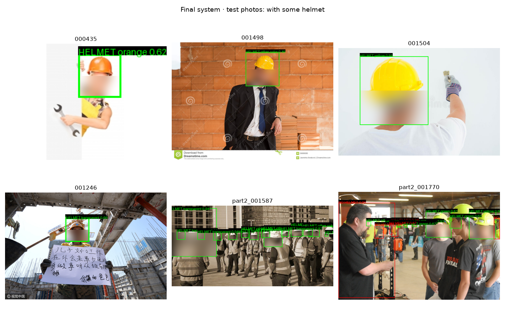
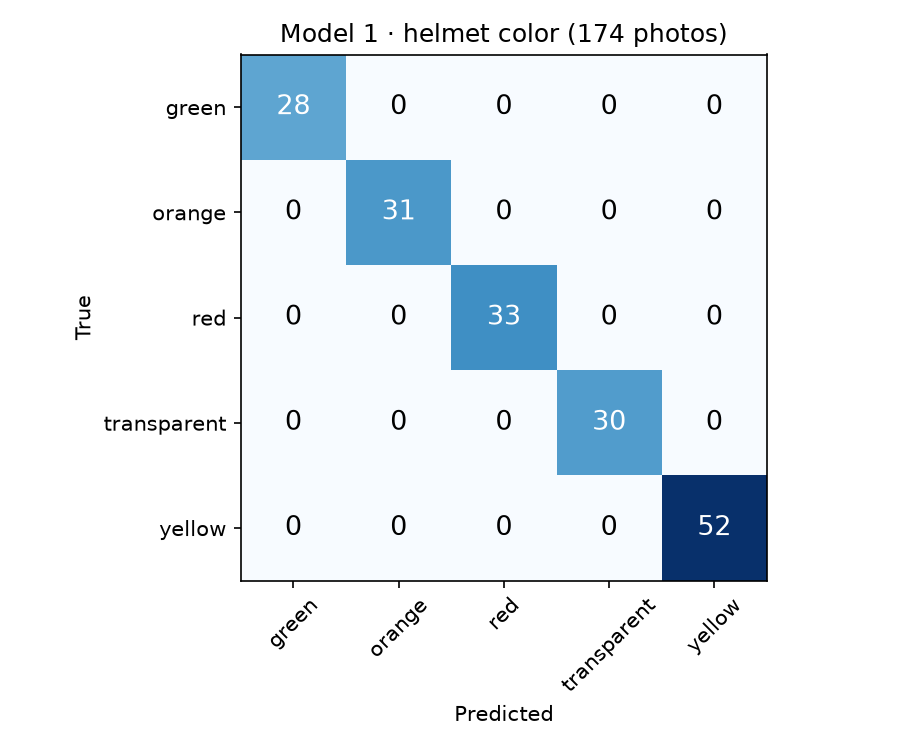
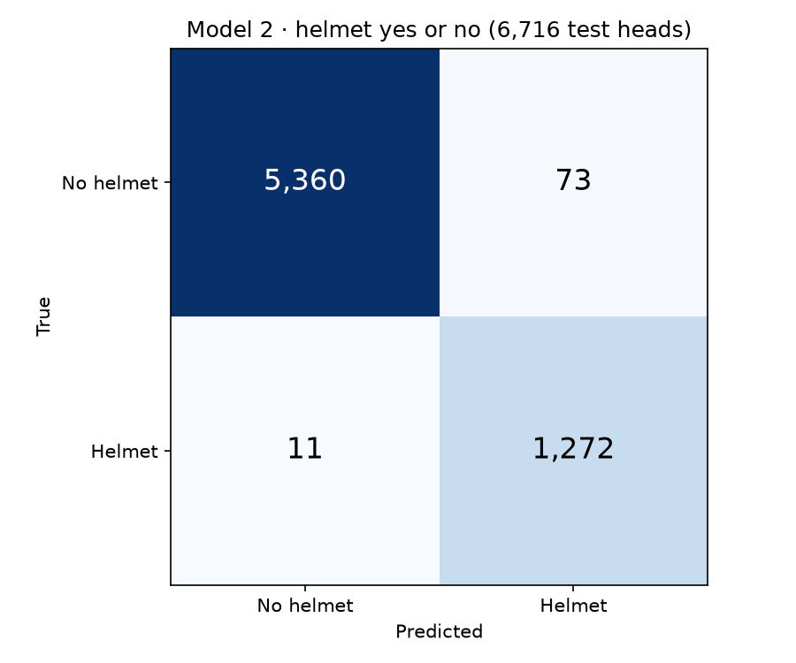
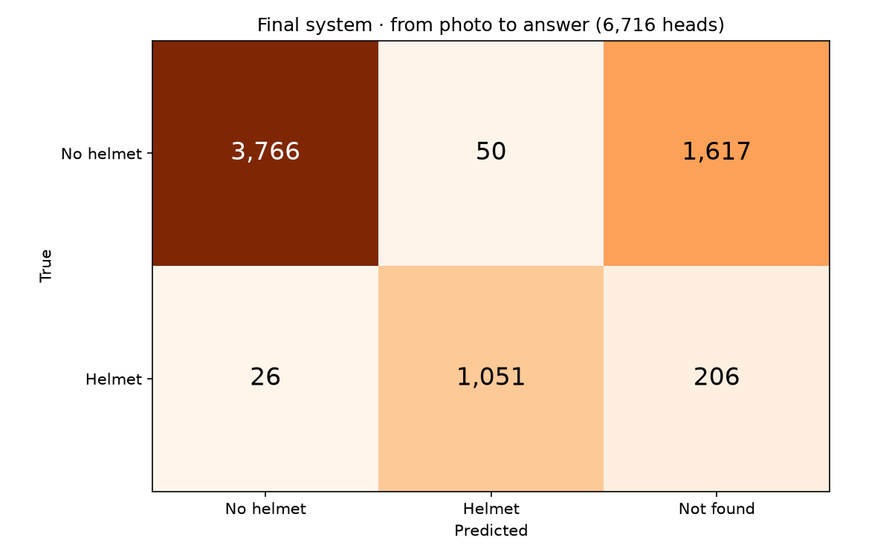

# Helmet detection on construction photos

A research prototype that looks at a photo, finds each person, decides if the person wears a safety helmet, and names the helmet color.

This repository holds the code behind the presentation *Helmet Detection Results* (October 2026). The 10 notebooks reproduce every number and figure in it, in order.



*Output of the final system on SHWD test photos. Faces are blurred.*

---

## Contents

1. [What the system does](#1-what-the-system-does)
2. [Key ideas in plain words](#2-key-ideas-in-plain-words)
3. [Results](#3-results)
4. [The data](#4-the-data)
5. [How to run it](#5-how-to-run-it)
6. [The notebooks, one by one](#6-the-notebooks-one-by-one)
7. [Limits](#7-limits)
8. [Licenses](#8-licenses)

---

## 1. What the system does

```
Photo
 │
 ▼  1. YOLOX-s finds a box around each person
 │
 ├─► 2. HELMET YES OR NO
 │      The whole person box → ResNet50 → one dense layer → P(helmet)
 │      P(helmet) < 0.5  →  "NO HELMET"
 │
 └─► 3. HELMET COLOR (only when P(helmet) ≥ 0.5)
        Keypoint R-CNN finds the nose, eyes, ears and shoulders → head crop
        Head crop → ResNet50 → one dense layer → P(green, orange, red, transparent, yellow)
        Highest P ≥ 0.6 → that color, else "other color"
```

Two different inputs decide two different things:
- **The whole person** decides the helmet. On real photos this was the most reliable way to get the helmet decision right.
- **The head crop** decides the color. In a whole-person image the head is only about 30 pixels tall, too small for the color. If the head crop is off, only the color can be wrong. The safety decision does not depend on it.

We got here in steps. First we trained a color model on our own helmet photos (Model 1). Then a helmet yes-or-no model on the heads of a public dataset (Model 2). Then we tried 3 ways to apply them to full photos, and kept the parts that worked.

## 2. Key ideas in plain words

| Term | Meaning |
|---|---|
| **Neural network** | A program that learns to map an input (an image) to an output (a label) from examples. It is made of layers of numbers called *weights*. Training adjusts the weights. |
| **ResNet50** | A well known image network with 23.6 million weights, already trained by others on **ImageNet** (1.2 million photos, 1,000 everyday classes). |
| **Feature vector** | The 2,048 numbers ResNet50 computes just before its last layer. They describe the image (shapes, textures, colors). Similar images get similar vectors. |
| **Transfer learning** | We keep ResNet50 **frozen** (its weights never change) and train only one small new layer on top of its feature vector. This works with few photos and trains in seconds. |
| **Dense layer** | The new layer we train. Each output is a weighted sum of the 2,048 numbers plus a bias. *Softmax* turns several outputs into probabilities that add up to 1 (used for color). *Sigmoid* turns one output into a probability between 0 and 1 (used for helmet yes or no). |
| **Data augmentation** | Making extra training images by flipping, rotating, zooming and changing the brightness of the ones we have. We never change the hue, because that would change the color class. |
| **YOLOX-s** | A pretrained *object detector*: it draws a box around each person in a photo. We use it as it is. |
| **Keypoint R-CNN** | A pretrained model that finds 17 body points per person (nose, eyes, ears, shoulders, …). We use them to place the head crop. |
| **Train / val / test** | Training photos teach the model. *Val* photos decide when to stop training. *Test* photos are used once, at the end, to measure the result on photos the model never saw. |
| **Confusion matrix** | A table that counts images by true class (rows) and predicted class (columns). Correct answers are on the diagonal. |
| **Sensitivity "no helmet"** | Of all heads without a helmet, the share the system found. This is the most important number for safety: a worker without a helmet marked as protected is the dangerous error. |


## 3. Results

### Model 1 · Helmet color (our helmet photos)

| | |
|---|---|
| Photos | 174 photos of 5 helmets (one helmet per color) on 6 backgrounds |
| Training images | 1,750 after augmentation (350 per color) |
| How we tested | Trained on 5 backgrounds, tested on the background left out, repeated for all 6 |
| Result | **174 of 174** photos correct |

ResNet50 without retraining called the helmets *crash helmet* in all 5 colors (notebook 02). That is why we replaced its last layer.

### Model 2 · Helmet yes or no (SHWD head crops, test photos only)

| | |
|---|---|
| Training heads | 24,079 head crops of 32 px or larger |
| Test heads | 6,716 heads from other photos |
| Heads **without** a helmet found | **98.7%** (5,360 of 5,433) |
| Heads **with** a helmet found | **99.1%** (1,272 of 1,283) |

These numbers assume the head is already cropped well, using the boxes drawn by the dataset authors.

### Full photos · 3 ways to give the model a head

All 3 were measured on the same 6,716 labeled heads of the SHWD test photos, from the raw photo to the answer.

| Strategy | Notebook | Found and correct |
|---|---|---|
| Fixed rule: crop the top 35% of the person box | 07 | 16.1% |
| Body keypoints locate the head | 09 | 67.1% |
| Whole person, no crop (retrained layer) | 08 | **71.7%** |

When a head was found, the helmet decision was right in about 98% of cases. The weak step was finding the head, not the model.

### Final system (notebook 10)

| In 1,517 SHWD test photos | Count |
|---|---|
| Persons found by YOLOX-s | 10,124 |
| Predicted with helmet | 1,669 |
| Predicted without helmet | 8,455 |
| Labeled heads, 32 px or larger | 6,716 |

| True ↓ / System answer → | No helmet | Helmet | Not found |
|---|---|---|---|
| No helmet (5,433) | 3,766 | 50 | 1,617 |
| Helmet (1,283) | 26 | 1,051 | 206 |

- 3,766 + 1,051 = 4,817 of 6,716 heads correct = **71.7%** found and correct.
- "Not found" = no person box held the head. Most of them are small heads in classroom photos.
- **The color was not measured**, because SHWD has no color labels. By eye: green, yellow and orange were mostly right; white helmets went to "other color"; opaque red helmets went to "other color" or orange (our red helmet is translucent and dark).

| Model 1 | Model 2 | Final system |
|---|---|---|
|  |  |  |

## 4. The data

The data is **not** in this repository. Place it in `data/` as shown in [data/README.md](data/README.md).

**Our helmet photos** (`data/helmets/`). 174 photos of 5 construction helmets (green, orange, red, transparent, yellow) on 6 plain backgrounds, with no person wearing them. They come from the project team. Use only the `Cartella DATASET Algoritmo convegno` folder; the other folder holds exact copies.

**SHWD, Safety Helmet Wearing Dataset** (`data/VOC2028/`). A public dataset with 7,581 photos. Its authors drew a box around each head by hand and labeled it `hat` (helmet) or `person` (no helmet; the name is misleading, it is a head). It has an official train / val / test split by photo. Download it from the [SHWD repository](https://github.com/njvisionpower/Safety-Helmet-Wearing-Dataset) (Google Drive link in its README) and unzip it so that `data/VOC2028/JPEGImages/` exists. License: research use.

## 5. How to run it

**Requirements:** Python 3.12, about 3 GB of free disk space, and preferably a GPU.

```bash
git clone https://github.com/EduardoTllo/helmet-detection.git
cd helmet-detection
python3.12 -m venv .venv
source .venv/bin/activate
pip install -r requirements.txt
```

Download the YOLOX-s person detector (36 MB):

```bash
curl -L -o models/yolox_s.onnx https://github.com/Megvii-BaseDetection/YOLOX/releases/download/0.1.1rc0/yolox_s.onnx
```

Put the data in `data/` (section 4), then open the notebooks:

```bash
jupyter notebook notebooks/
```

Run the notebooks **in order, from 01 to 10**. Each notebook reads what the previous ones saved. Figures and tables go to `outputs/`, trained models to `models/`. The ResNet50 and Keypoint R-CNN weights download by themselves the first time.

To run all of them from the terminal instead:

```bash
cd notebooks
for f in *.ipynb; do jupyter nbconvert --to notebook --execute --inplace --ExecutePreprocessor.timeout=-1 "$f"; done
```

The results are fixed by random seeds, so the numbers should match the tables above. Small differences in the last digit can appear on other hardware.

## 6. The notebooks, one by one

| # | Notebook | What it does | Slide in the presentation | Approx. time* |
|---|---|---|---|---|
| 01 | [Helmet photos overview](notebooks/01_helmet_photos_overview.ipynb) | Counts our helmet photos by color, background, camera and day | Goal and data; Our helmet photos | < 1 min |
| 02 | [ResNet50 as is](notebooks/02_resnet50_as_is.ipynb) | Shows that the pretrained network gives object names, not colors | Model 1 · Helmet color | < 1 min |
| 03 | [Data augmentation](notebooks/03_data_augmentation.ipynb) | Turns 174 photos into 1,750 images (350 per color) | Data augmentation | 1 min |
| 04 | [Helmet color model](notebooks/04_helmet_color_model.ipynb) | **Model 1.** Trains the color layer and tests it one background at a time | Model 1; Confusion matrices | 2 min |
| 05 | [Prepare SHWD heads](notebooks/05_prepare_shwd_heads.ipynb) | Crops 33,393 labeled heads and saves one ResNet50 vector per head | Goal and data; Model 2 | 8 min |
| 06 | [Helmet head model](notebooks/06_helmet_head_model.ipynb) | **Model 2.** Trains helmet yes or no on head crops; joins Models 1 and 2 | Model 2; Confusion matrices; Limits (caps and hats) | 2 min |
| 07 | [Fixed rule head crop](notebooks/07_fixed_rule_head_crop.ipynb) | Full photos, strategy 1: YOLOX-s + a fixed rule to crop the head | Three ways to find the head; The fixed rule | 4 min |
| 08 | [Whole person](notebooks/08_whole_person.ipynb) | Full photos, strategy 2: the whole person box goes into the model | Three ways to find the head | 11 min |
| 09 | [Body keypoints](notebooks/09_body_keypoints.ipynb) | Full photos, strategy 3: Keypoint R-CNN places the head crop | Three ways to find the head | 11 min |
| 10 | [Final system](notebooks/10_final_system.ipynb) | Whole person for the helmet, head crop for the color, "other color" threshold; counts and final confusion matrix | Final architecture; Final results; Final confusion matrix | 13 min |

\* Measured on a MacBook with Apple Silicon.

`notebooks/yolox_person_detector.py` holds the YOLOX-s code (image resize, decoding of the 8,400 predictions and non-maximum suppression). Notebook 07 explains each step.

Each notebook starts with a short explanation of what it does and why, and ends with what we learned. The outputs saved in the notebooks are the ones used in the presentation. Figures that show our private helmet photos were removed from the saved outputs; they appear when you run the notebooks with the data.

## 7. Limits

- **Caps and hats.** 73 of 5,433 heads without a helmet were marked as helmet in Model 2. Many wore caps, straw hats or hoods. Most SHWD heads without a helmet are bare heads, so the model rarely saw caps.
- **One helmet per color.** Model 1 may recognize *that* helmet and not its color. No helmet in our photos is worn by a person, so the color on real photos was only checked by eye.
- **"Other color" threshold.** 0.6 is a starting value. There were no labeled helmets of other colors to set it.
- **Test photos used more than once.** We compared several variants on the same SHWD test photos, so the 71.7% may be a little optimistic. New test photos, used only once, would give a clean number.
- **Next data to collect:** photos of colleagues wearing our 5 helmets (with consent), helmets of other colors labeled by people, and heads with caps and hats labeled as "no helmet".

## 8. Licenses

| Component | License |
|---|---|
| YOLOX-s (Megvii) | Apache-2.0 |
| Keypoint R-CNN (torchvision) | BSD-3-Clause; weights trained on COCO |
| ResNet50 ImageNet weights (Keras) | ImageNet terms of use (non-commercial research) |
| SHWD | Research use; its helmet photos were collected from Google and Baidu |
